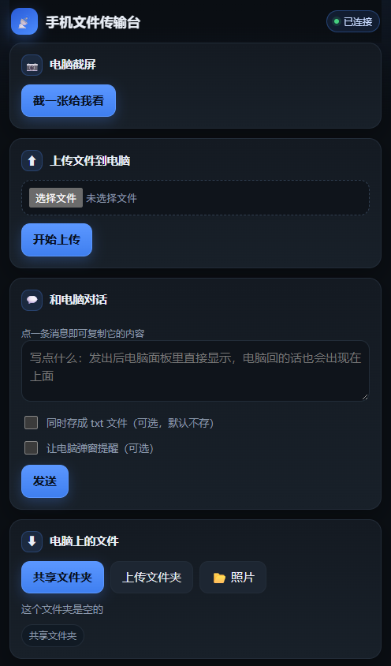

# dsh-file-station（文件传输台 · DSH 插件版）

把「文件传输台 v1.2」从 Python 单文件程序改造成 DeepSeek Harness 插件：
**手机端界面完全保留**（手机浏览器上传/下载/截屏/发文字/留言），控制台从 tkinter 窗口搬进 DSH Web GUI 的整页面板。



*手机浏览器打开访问地址后的界面：截屏、上传、双向对话、下载。*

## 它做什么

- **手机 → 电脑**：上传文件（边收边写、断点丢弃、磁盘空间检查）、发一段文字存成 `文本-*.txt`、发一条留言（电脑弹窗提醒）。
- **电脑 → 手机**：浏览「共享」目录、下载（流式 + Range 断点续传）、查看共享目录里最近 30 个 `.txt`、一键截屏返回 PNG。
- **桌面拖拽直达共享**：把文件从资源管理器拖进文件传输台面板，直接写入 `共享\`（手机打开传输台即可看到并下载），不会进 `上传\`。
- **拖拽不依赖 Content-Length**：浏览器 `fetch(File)` 以 chunked 发送，后端改为边收边计数，不再要求长度头；文件夹不能直接拖入，会提示「空文件或不是文件」。
- **GUI 面板**：手机访问地址与二维码（默认隐藏，手动「显示」后才出现，90 秒自动收起）、打开共享/上传/数据目录、立即截屏并预览、重置访问码、最近上传与文字、手机留言、额外共享目录管理。

## 安装

三种方式等价，都会把包写进 profile 的 `dsh.profile.bundles`（实测过）。

**从 GitHub 安装（推荐，换机器也能用）**

```powershell
dsh plugin --profile desktop add "git+https://github.com/xyf981528-sys/DeepSeek-Harness-.git#path:/dsh-file-station"
```

**从本地目录安装（开发机）**

```powershell
dsh plugin --profile desktop add "D:\DeepSeek Y\dsh-file-station"
```

**在 DSH 界面里装**：插件管理器 → 安装本地包 → 选这个目录（等价于 `plugin_manager` 的 `install_bundle`，target 为绝对路径）。

装完重启 DSH / 刷新 Web GUI 生效。当前版本的侧边栏入口收在「工具箱」里，点「文件传输台」的「展开详情」打开面板；profile 里装成 junction 链接（改源码即生效），Host 代码改动仍需重启 DSH 才加载。

## 使用

1. 打开侧边栏「文件传输台」。**地址和二维码默认是隐藏的**：点一下「👁 显示连接地址」才会出现，90 秒后自动收起（收起后二维码立即失效）。这样旁边的同事/家人不会看到访问码。
2. 手机连同一个 WiFi，用浏览器打开该地址（末尾带 `?k=访问码`，服务端会把它换成 HttpOnly Cookie 并跳到 `/`，下次不用再带），或者直接扫面板上的二维码。
3. 手机页面：📷 截屏、⬆ 上传、💬 和电脑对话、⬇ 浏览下载、📄 看文字（深色卡片界面，适配刘海屏/安全区）。
4. **文字/留言是双向的**：手机和电脑共用一条对话流——面板里直接显示手机发来的文字，也能在输入框写一句点「发送」推到手机；手机页每 4 秒刷新，电脑发的话以左侧气泡出现。
5. **发文字默认不生成文件**：勾选「同时存成 txt 文件」才会在 `共享\` 里写 `文本-*.txt`（老行为）；勾选「让电脑弹窗提醒」则额外在电脑上响铃弹窗（相当于原「留言」）。
6. **手机上复制文字**：对话里点一条消息即可复制；「电脑上的文字」点一下正文也能复制全文。「📋 复制全文 / 全选」按钮放在正文**上方**（正文限高、内部滚动），长按全选时系统菜单不会盖住按钮。
7. **想访问工作目录之外的盘**：面板「额外共享目录」里直接填盘符，例如 `D:\`（会弹一次确认），手机就能从盘符根往下浏览、下载；数据目录、`.ssh`、`AppData`、`C:\Windows` 等敏感位置始终不会出现在列表里，也访问不到。
8. **传完有提示**：手机每传完一个文件，屏幕下方冒一条「✅ 文件名 已传完」，全部结束再汇总一条；电脑面板同时弹「文件已传完：文件名（大小）」。手机点文件下载时也会提示「开始下载」。

## 手机消息自动叫醒 DSH（v0.1.1 新增）

以前手机发来文字，DSH 里的助手并不知道，要你回到电脑前再问一句「有没有消息」。现在 Host 会盯着收件箱：

- 手机端发**文字/留言**时，这条内容会作为一条用户消息投递给当前会话的 Agent（`agent.followup()`），Agent 被直接唤醒，能看到内容并接着处理。
- 只对文字/留言生效；**上传文件不唤醒**（避免大文件传输刷屏）。手机页面、收件箱、面板行为都不变。
- 投递失败只写 `remote.log`（`AGENT-NOTIFY-ERR`），不影响手机请求和收件箱。
- 默认开启。关闭方式（profile 的 `cordis.patch.yml` 末尾追加）：

  ```yaml
  - id: file-station
    config:
      notifyAgent: false
  ```

  注意 `config` 是整块替换：如果要同时改端口，把 `port` 一起写上。

## 装到手机桌面（PWA，v0.1.2）

手机页现在带 manifest + Service Worker + 图标，浏览器支持时可以直接装到桌面：

- 打开手机页 → Chrome 右上角 ⋮ → **安装应用 / 添加到主屏幕**；
- 装好后从桌面图标进入，独立窗口、无地址栏（`display: standalone`）；
- 名称和图标来自 `pwa/manifest.webmanifest`，`pwa/` 里有 192/512/maskable 和 Apple touch 图标；
- 改了图标重新生成：`python scripts/make-pwa-icons.py`（Pillow）。

**重要限制（HTTPS）**：Chrome 只对「安全上下文」开放 Service Worker 和安装能力——也就是 `https://`，或本机 `http://localhost` / `127.0.0.1`。
手机用 `http://192.168.x.x:19790` 访问时：

- 页面功能完全正常，manifest 也能读；
- 但 Service Worker 会被浏览器拒绝注册，**「添加到主屏幕」一般只生成普通快捷方式**（带图标，但仍是浏览器标签页），不是独立窗口。

要真正的独立 App，两条路：给手机端加 HTTPS（自签证书 + 手机安装 CA），或者做 WebView 壳 APK（不受这个限制）。

桌面 Chrome 用 `http://127.0.0.1:19790` 验证过：manifest 200、SW `activated`、`beforeinstallprompt` 会触发。

## 手机 HTTPS（v0.1.3）

PWA 要真正装到手机，必须走 https。插件现在会在 HTTP 端口之后自动再开一个 HTTPS 监听（19790 → 19791，被占用则顺延），前提是 `certs/` 里有证书。

### 生成证书（电脑上，一次）

```powershell
python scripts/make-cert.py
```

- 首次生成 CA（`certs/ca.crt.pem`），之后复用；换 IP 只重签服务器证书，手机不用重装 CA。
- 服务器证书自动包含本机局域网 IP、127.0.0.1、localhost 和主机名。
- `certs/` 已加入 `.gitignore`，私钥不会进仓库。

### 手机安装 CA（一次）

1. 手机浏览器打开 `http://<电脑IP>:19790/pwa/ca.crt` 下载（走 HTTP，不会先弹证书警告）。
2. Android：设置 → 安全 → 加密与凭据 → 安装证书 → **CA 证书** → 选刚下载的 `.crt`。
   （不同品牌路径略有差异，常见在「安全 → 更多安全设置 → 加密与凭据」。）
3. 装好后用 `https://<电脑IP>:19791/?k=访问码` 打开；面板上显示的地址和二维码会自动变成 https。
4. Edge/Chrome 菜单 → 安装应用；这次可以真正安装成独立窗口。

### 注意

- HTTPS 端口 = HTTP 端口 + 1；被占用会顺延，以 `remote.log` 里的 `=== HTTPS === port=` 或面板地址为准。
- 电脑 IP 变了：重跑 `python scripts/make-cert.py`，重启 DSH；手机上的 CA 不用重装。
- 自签 CA 只装在你自己的手机上，不要装到不信任的机器。

## 大文件分片上传（v0.2.0）

- 手机端选中的文件 **超过 6 MB** 自动切成 1 MB 一片上传；小文件仍是单次 POST。
- **断点续传**：同一文件（名称+大小+修改时间一致）断网/关页后重新选择并上传，会从上次确认的分片继续；进度条、`已传 x%` 实时刷新。
- **可取消**：上传中显示「取消」按钮；取消会中止在途请求、清掉本地续传记录，并调用 `/upload/abort` 删除服务端分片。
- 服务端校验：分片数量、总大小必须与申报一致才合并；合并在目标目录写临时文件后原子 rename；`data/_chunks/` 残留 24 小时自动清理。
- 取消采用「墓碑标记」（`_chunks/_aborted/<uploadId>`），避免 abort 之后在途分片把目录重新建回来。
- 安全不变：仍走令牌鉴权、Origin 校验、`safeName` 文件名过滤、磁盘余量检查与 8 GB 上限。

## 图片压缩 / 毛玻璃 / IPv6（v0.3.0）

- **图片压缩**：上传卡片里勾选「上传前压缩图片」（默认勾选）。图片大于 300 KB 时用 `createImageBitmap` + canvas 压到长边 1600、JPEG 0.9，文件名改成 `.jpg`；GIF/SVG/解码失败原样上传。压缩后通常只剩原图的 1/5～1/10，原图不会另存。
- **毛玻璃 UI**：卡片改成半透明 + `backdrop-filter: blur(18px) saturate(1.35)`，背景加了两团低透明度光晕；不支持 `backdrop-filter` 的浏览器自动回退为实色卡片。
- **IPv6 双栈**：HTTP 与 HTTPS 监听都先绑 `::`（Windows 上同时接受 IPv4），系统不支持时回退 `0.0.0.0`。IPv4 地址不变，局域网里 IPv6-only 的设备也能连。
  - HTTPS 证书目前只签了当前 IPv4/IPv6 回环，**通过 IPv6 访问建议用 HTTP**；要 HTTPS over IPv6，重跑 `scripts/make-cert.py` 时把 IPv6 地址作为参数传进去。

## 设备配对（本机点击确认，v0.4.0）

令牌不再是唯一门槛：新设备第一次打开（扫码或带 `?k=`）会进入「等待电脑确认」页，电脑上弹出「文件传输台 · 设备配对」窗口，点「允许」才放行。

- 点「拒绝」→ 设备标记 `blocked`，手机页显示「电脑已拒绝」，可点「重新申请」再走一次；
- 本机回环（`127.0.0.1` / `::1`）默认直接放行，方便电脑自己测试；`trustLoopback: false` 可关掉；
- 设备记录在 `data/_devices.json`（名称 / UA / 状态 / 时间），确认后一年内免重复确认；
- 未批准设备除 `/pair/status` 外**所有路由 403**，看不到文件列表，也传不了文件；
- 调试时可设 `pairDialog: false`（只记录不弹窗），不建议在生产用；
- 关闭整套确认：`requireApproval: false`（会退回旧的「有令牌即放行」行为）。

```yaml
- id: file-station
  config:
    requireApproval: true
    trustLoopback: true
    pairDialog: true
```

升级后第一次连接会弹一次确认，这是预期行为。

## 数据位置

默认是**插件目录下的 `data`**，即 `D:\DeepSeek Y\dsh-file-station\data`（跟随插件所在盘，不再写 C 盘）。

首次启动时如果这个目录还没有数据，会自动从旧目录**复制**（不移动，原数据保留）一份过来：

- `%USERPROFILE%\.dsh\file-station`（上一版的默认目录）
- `D:\DeepSeek E`（更早一版写死的默认目录）

| 名称 | 用途 |
| --- | --- |
| `上传\` | 手机上传的文件 |
| `共享\` | 手机可浏览/下载的文件；电脑拖进面板的文件也存这里；勾选「存成 txt」时，手机发来的文字也存这里 |
| `收件箱.jsonl` | 双向对话流（`{t, from: phone\|pc, kind: text\|msg, text, saved}`；保留最近 500 条，超过 800 条自动收缩） |
| `_token.txt` | 访问码（面板里可重置） |
| `留言.jsonl` | 旧版留言历史；首次启动会并入 `收件箱.jsonl` 并改名为 `留言.jsonl.migrated`（历史不丢） |
| `额外共享目录.txt` | 每行一个额外共享目录 |
| `remote.log` | 运行日志（超过 5 MB 轮转） |
| `shot.png` | 最近一次截图 |
| `_notify.ps1` | 弹窗提醒脚本（纯 ASCII，中文文案走环境变量，避开 PS 5.1 编码坑） |

## 配置

默认端口 **19790**（被占用就在 19790–19829 里顺延；19777 留给独立 exe 版，避免撞车）。需要改的话在 profile 的 `cordis.patch.yml` **末尾追加**一条（不要写 `name`，也不要整份覆盖）：

```yaml
- id: file-station
  config:
    port: 19790
    dataDir: 'D:\手机传输'
```

## 与 Python 版的差异

- 二维码改成插件内置：`lib/vendor/qrcode.js` 是 qrcode-generator 1.4.4（MIT，Kazuhiko Arase），Host 端直接生成 SVG，面板里扫码即可连上手机页。
- 没有开机自启复选框：由 DSH 启动时自动加载插件；自定义快捷方式请自行处理。
- 通知弹窗仍是 PowerShell + WinForms（与原版同一套逻辑），只是脚本改为运行时生成、文案从环境变量读取。
- 手机页面样式与流程保持原样；接口路径（`/files`、`/upload`、`/text`、`/queue`、`/shot.png`、`/download`…）与原版一致，旧书签可继续用（访问码换了就要重新打开一次）。
- **发文字的行为改成了"默认不落文件"**：Python 版每发一次必写一个 `文本-*.txt`；插件版默认只进对话流（`收件箱.jsonl`）并在面板里显示，勾选后才写文件。`POST /text` 的返回体相应多了 `saved` 字段（`true` 时才有 `name`）。
- **对话是双向的**：新增动作 `send-to-phone`（面板 → 手机）；`POST /text` 支持 `notify: true`（手机端勾「让电脑弹窗提醒」时触发桌面提醒）；`GET /inbox` 返回 `{t, from, kind, text, saved}`，两侧共用。
- GUI 面板接口只监听本机回环（`/file-station/api/*`），并校验 Host/Origin，外部网站无法跨站调用。

## 安全

- **访问码**：128 位（32 位十六进制），`?k=` 或 Cookie 携带；比较用 `crypto.timingSafeEqual`，不泄露长度差异。
- **HttpOnly Cookie**：用 `?k=` 打开页面时，服务端写 `Set-Cookie: k=…; HttpOnly; SameSite=Lax` 并 302 到 `/`——页面 JS 读不到令牌，浏览器历史与地址栏也不留 `?k=`。
- **按 IP 退避**：同一 IP 连续错 5 次起冷却 30 秒，指数翻倍、上限 10 分钟；冷却期内正确令牌也拒绝（防在线爆破），并返回 `Retry-After`。
- **全局熔断**：10 分钟内累计 120 次失败，整个服务锁 10 分钟（防分布式猜码）。
- **跨站防护**：写操作（POST）校验 `Origin` 必须与本机同源、`Sec-Fetch-Site: cross-site` 直接 403；Cookie 本身 `SameSite=Lax`。
- **路径白名单**：`realpath` 后再按根目录比较（不是 `startsWith` 字符串），`..\` 与符号链接逃逸都会 403。
- **额外共享目录的边界分两层**：添加时拒绝 UNC 路径、`C:\Windows`、Program Files、ProgramData、`AppData`、`.dsh`、`.ssh` 和数据目录本身（整块盘如 `D:\` 允许，面板会先弹确认）；请求时 `isProtected()` 再兜一层——即使整块盘都在共享里，数据目录（访问码/日志/对话）、`.dsh`、`.ssh`、`AppData`、系统目录也不会被列出或下载。最多 20 个额外目录。
- **`/text` 只读文本**：仅允许 `.txt/.md/.log/.json/.csv/.yml/...` 等扩展名，隐藏文件（`.env`、`.git` 里的东西）与超过 200 KB 的文件一律拒绝——令牌泄露也不能把它当任意读文件接口。
- **上传限制**：必须带 `Content-Length`、单文件 ≤ 8 GB、磁盘保留 200 MB 余量、文件名过滤控制字符与 `\/:*?"<>|`、Windows 保留名（`CON`/`PRN`/`COM1`…）自动加 `_` 前缀、截断 120 字符。
- **响应头**：手机页带 `Content-Security-Policy`（`default-src 'self'`，禁 iframe、禁外链）、`X-Frame-Options: DENY`、`X-Content-Type-Options: nosniff`、`Referrer-Policy: no-referrer`、`Permissions-Policy` 关闭摄像头/麦克风/定位；所有响应 `Cache-Control: no-store`。
- **资源上限**：`maxConnections = 64`、`headersTimeout = 30s`、`requestTimeout = 30min`（慢速大文件可传完，但不会无限挂住）；截屏最小间隔 3 秒（防刷 PowerShell）。
- **面板隔离**：`/file-station/api/*` 只在本机回环可用，并校验 `Host`/`Origin` 必须是 loopback；手机端无法访问面板接口。
- **已知边界**：局域网 HTTP 明文，同一 WiFi 下有抓包能力的人可看到传输内容；需要更强保密时请用 VPN/热点隔离，或把访问码当成一次性凭证定期在面板里「重置访问码」。

## 开发笔记

- **Host 代码改动要重启 DSH 才生效**。不要在会话里用插件管理器「关掉再打开」来热重载：那会整份重写 profile 的 `package.json` 和 `cordis.patch.yml`，中断就会丢配置。
- `cordis.patch.yml` 只追加、不覆盖；**给已有 id 打补丁时不要写 `name`**（只有 `insert` 新增条目才写）。
- `package.json` 绝不能带 BOM（否则 `Unexpected token` 直接起不来）。
- 改完先过三关：`node --check` 每个 js → `node -e "import('file:///D:/DeepSeek Y/dsh-file-station/lib/index.js').then(m=>console.log(Object.keys(m)))"`（应输出 `apply,inject,name`）→ 假 ctx 冒烟测试（`{ logger, effect, webServer: { register } }`）。
- 模块顶层不允许有副作用：不 mkdir、不 listen、不读文件，全部放进 `apply()` 的 `ctx.effect()`。